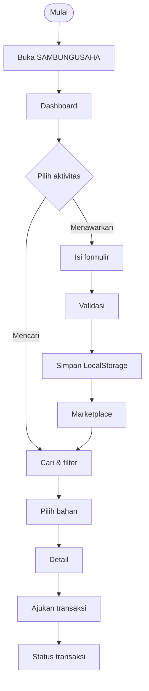

# SAMBUNGUSAHA — Prototype INDONERIS 2026
Sisa Bahanmu, Peluang Usaha Mereka.

## Menjalankan
Buka folder di VS Code → klik kanan `index.html` → *Open with Live Server* (atau klik dua kali file). Perlu internet (CDN Bootstrap & Chart.js).

## Flowchart utama (Mermaid)

Ekspor: tempel di https://mermaid.live → Actions → PNG/SVG. Atau di VS Code: ekstensi "Markdown Preview Mermaid Support".

## Sitemap
index → dashboard → marketplace → detail → transaksi; dashboard → tambah-bahan → marketplace; rekomendasi, dampak.

## Panduan
- **Warna**: ubah variabel `:root` di `css/style.css`.
- **Kategori baru**: tambah di `CATEGORIES` pada `js/data.js` (nama: ikon Bootstrap).
- **Data UMKM/bahan**: tambah objek di `SEED_MATERIALS` (`js/data.js`).
- **Reset data**: DevTools → Application → Local Storage → hapus `su_materials`, `su_transactions`.
- **Backend nanti**: ganti fungsi `getMaterials/saveMaterial/getTx/saveTx` di `js/main.js` dengan `fetch()` ke API.

## Belum dikembangkan (TODO tim)
Login+backend, database, chat, pembayaran, verifikasi UMKM, notifikasi, ML rekomendasi, peta, admin, keamanan/deployment. Pencarian TODO ada di `js/data.js` & `js/app.js`.

## Checklist pengujian
Navigasi semua menu · cari "kopi" · filter kategori/lokasi/harga · urutkan · buka detail · ajukan transaksi (muncul di Transaksi) · tambah bahan (muncul di Marketplace setelah refresh) · validasi form kosong · resize HP/tablet · Console tanpa error.
